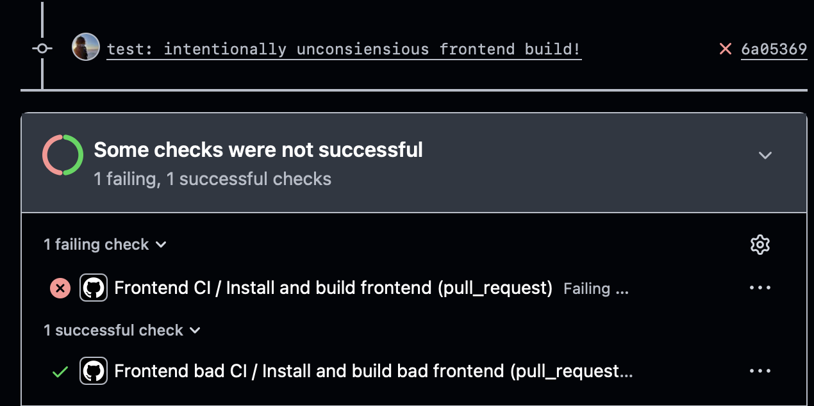

### CI/CD
Вся логика ci / cd находится в корневой .github/workflows...

## Кто такой CI (на примере Github Actions)
CI - проверка, чтобы плохой код не дошел до прода. 
Github actions - запускает workflow, читает yaml определяет задания и их делает. Создается виртуальная машина, выполняются шаги и говорит итог.
Workflow - весь сценарий
job - отдельное задание
step - отдельное действие или команда в job
runner - машина на которой будет job 

## Frontend bad CI
Создадим bad CI для frontend'а на vite/vue.

Назовем весь CI как Frontend bad CI.
on - говорит о том когда выполняется CI
В bad - при пуше и пулл реквесте в мейн, и тут уже сразу мини-ошибка, при изменении вообще никак с фронтом не связанных вещей, будет запускаться CI, в нашем контексте это не очень хорошо, фронт не зависит так сильно от бекенда, поэтому надо добавлять paths/, который гласит об ограничении автоматических запусков изменениями в конкретных файлах по этому path. 
Workflow_dispatch - позволит запускать сценарий вручную через интерфейс gh actions без лишних коммитов.

Далее создадим jobs которые будут выполняться, в нашем случае сборка - build. Обычно делают test, build, deploy работы. Их мы тоже добавим, но пишу я этот кусок перед их добавлением.

Обзовем ее, в bad - Install and build bad frontend.
runs-on - гласит о том на чем будет запускаться CI, виртуализация) В плохом примере сделали ubuntu-latest, так нельзя, одному Аллаху будет известно как оно запускаться будет на новых версиях, поэтому по хорошему все фиксируют под конкретные, чтобы не было unexpected.
Далее сделали сразу steps, шаги, поочередно короче делает CI, шаг за шагом, год за годом.

uses: actions/checkout@v4 : uses - гласит что вместо shell мы запускаем готовый github action. actions/checkout - скачивает исходный код репозитория в runner, @v4 - тег версии action.

actions/setup-node@v4 - action который устанавливает node.js и добавит его в PATH.
with - передает параметры в action, node-version - версия. В плохом CI , опять одному Аллаху будет известно как оно будет работать. Новая версия может изменить поведение инструментов или перестать поддерживать какой-либо пакет.

working-directory: lab0/frontend - задает каталог в котором будет выполняться команда этого шага, нам это важно, ведь package.json - не в корне репозитория, а в конкретной папке. Своего рода "cd lab0/frontend" но на github'овском.

В плохом:
run:npm install, ну устанавливает зависимости, после установки ничего не проверил. А установиться вполне может успешно. А еще npm install может обновлять lock-файл в зависимости от состояния манифеста и лок файла. В CI, как и в docker, лучше использовать npm ci. Он строго устанавливает версии из package-lock.json и завершается ошибкой при несовместимости манифеста и lock-файла.

Запустим наши CI! (потом покажу хороший)


А ведь ошибка явная, синтаксическая. Почему прошло? Так мы не проверили npm run build. Плохой все скачал а ничего не сделал, а хороший еще и проверил)

```
name: Frontend bad CI

on:
    push:
        branches: [main]
    pull_request:
        branches: [main]

jobs:
    build:
        name: Install and build bad frontend
        runs-on: ubuntu-latest

        steps:
            - name: Checkout
              uses: actions/checkout@v4
            - name: Install latest Node.js
              uses: actions/setup-node@v4
              with:
                node-version: "latest"
            - name: Install dependencies
              working-directory: lab0/frontend
              run: npm install
            # Чтобы максимально плохо было, можно убрать две строчки ниже) 
            # - name: Build frontend
            #   run: npm run build
```

## Frontend g00d CI
Многое похоже, но их интересного, указали явно paths. Уже говорил зачем.

Явно указали permissions, это считается правильной и хорошей практикой. Он ограничивает права встроенного токена GITHUB_TOKEN в рамках workflow. В ситуации у нас contents: read, разрешает читать содержимое репозитория, что нужно для checkout, при этом workflow не имеет права на запись в содержимое репозитория. Для конкретно frontend, этого сполна хватает.
Необходимо выдавать хотя бы минимальные привилегии, а точнее, выдаем то - что реально нужно.

concurency - конкурентность, управляет одновременными запусками workflow (допустим 2 коммита одновременно). group: ... определяет группу в которой github координирует задания, а внутреняя составляющая гласит о ком речь. И где координировать
cancel-in-progress: true, отмена старого если появился новый.

Указали явную известную людям версию ubuntu, и node.js. Это правильно, ну понятное дело почему.

defaults - какие то штуки по умолчанию для всех шагов, в нашем случае - рабочая директория. Он влияет на shell команды, но не на каталог выполнения actions через uses

cache: npm - kеширование npm-зависимостей через actions/setup-node, повторные запуски могут восстановить кеш и быстрее пройдет проверка. Кеш идет именно npm, не node_modules/vite build.

npm ci вместо npm install - npm ci специален для автоматизированных сборок, устанавливает фиксированные зависимости и завершится ошибкой при несовместности.

Ну и ключевое, npm run build. Он вызывает скрипт из package.json 
```
{
  "scripts": {
    "build": "vite build"
  }
}
```
Vite компилирует сайт под прод и формирует каталог dist/, если есть ошибки синтаксиса в js то завершится сборка с ошибкой, и gh actions пометит шаг как failure.


Ну и под конец добавим static analysis, test'ы, форматтинг. Особо расписывать не буду.
```npm install --save-dev --save-exact eslint @eslint/js globals prettier vitest@2.1.9```
Но вообщем добавил линтер форматтер и тесты, это уже нюансы фреймворка.


```
name: Frontend CI

on:
    push:
        branches: [main]
        paths: 
            - 'lab0/frontend/**'
            - '.github/workflows/frontend-ci.yml'
    pull_request:
        branches: [main]
        paths: 
            - 'lab0/frontend/**'
            - '.github/workflows/frontend-ci.yml'
    workflow_dispatch:
        
permissions:
    contents: read

concurrency:
  group: frontend-ci-${{ github.ref }}
  cancel-in-progress: true

jobs:
    build: 
        name: Install and build frontend
        runs-on: ubuntu-24.04

        defaults:
          run:
            working-directory: lab0/frontend

        steps:
            - name: Checkout repository
              uses: actions/checkout@v4
              
            - name: Setup Node.js
              uses: actions/setup-node@v4
              with:
                    node-version: '22.23.3'
                    cache: 'npm'
                    cache-dependency-path: lab0/frontend/package-lock.json
            - name: Install dependencies
              run: npm ci
              
            - name: Static analysis
              run: npm run lint

            - name: Check formatiing 
              run: npm run format:check

            - name: Run tests
              run: npm test

            - name: Build frontend
              run: npm run build
```