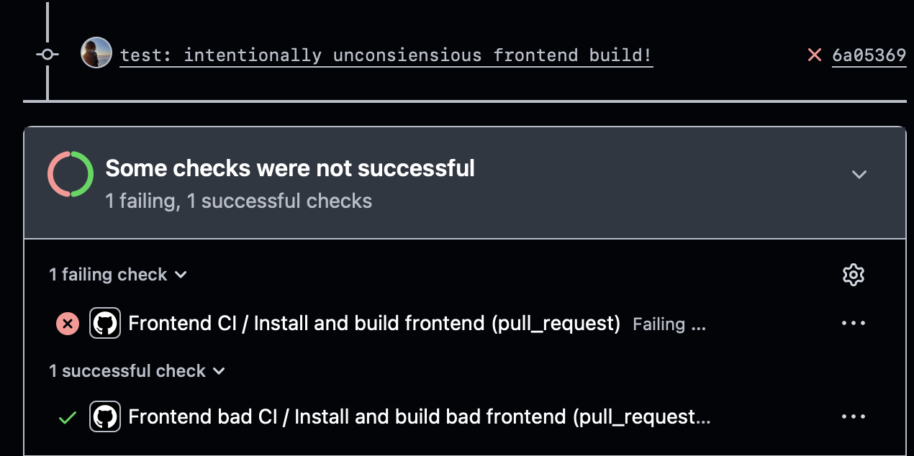
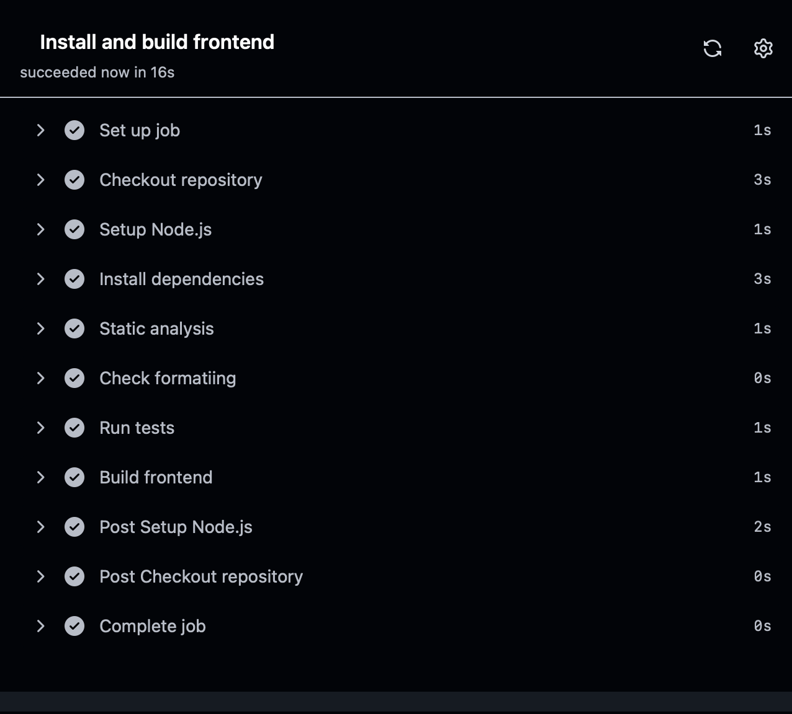
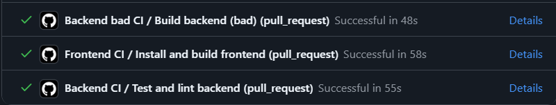
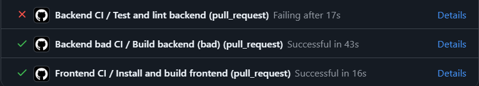
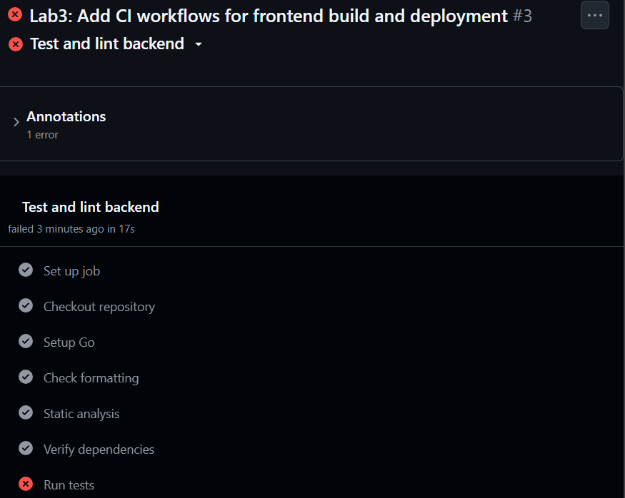
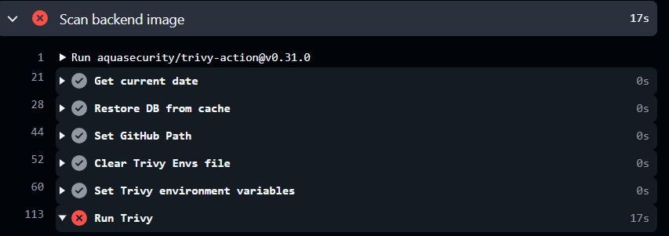
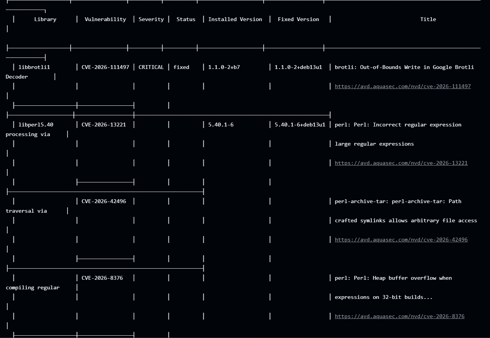
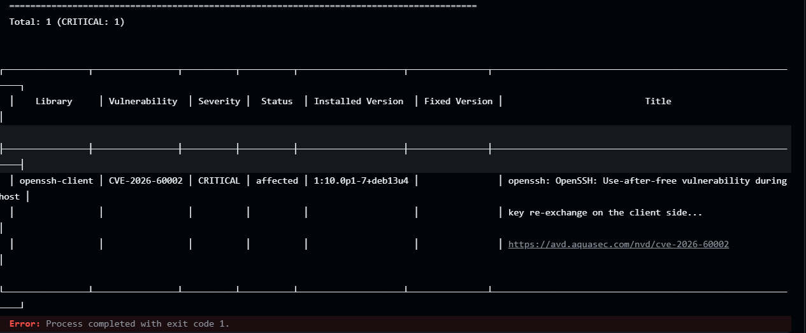
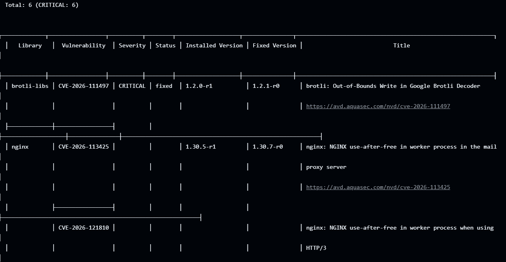

### CI/CD
Вся логика ci / cd находится в корневой .github/workflows...

## Кто такой CI (на примере Github Actions)
CI - проверка, чтобы плохой код не дошел до прода. 
Github actions - запускает workflow, читает yaml определяет задания и их делает. Создается виртуальная машина, выполняются шаги и говорит итог.
Workflow - весь сценарий
job - отдельное задание
step - отдельное действие или команда в job
runner - машина на которой будет job 

## Frontend bad CI
Создадим bad CI для frontend'а на vite/vue.

Назовем весь CI как Frontend bad CI.
on - говорит о том когда выполняется CI
В bad - при пуше и пулл реквесте в мейн, и тут уже сразу мини-ошибка, при изменении вообще никак с фронтом не связанных вещей, будет запускаться CI, в нашем контексте это не очень хорошо, фронт не зависит так сильно от бекенда, поэтому надо добавлять paths/, который гласит об ограничении автоматических запусков изменениями в конкретных файлах по этому path. 
Workflow_dispatch - позволит запускать сценарий вручную через интерфейс gh actions без лишних коммитов.

Далее создадим jobs которые будут выполняться, в нашем случае сборка - build. Обычно делают test, build, deploy работы. Их мы тоже добавим, но пишу я этот кусок перед их добавлением.

Обзовем ее, в bad - Install and build bad frontend.
runs-on - гласит о том на чем будет запускаться CI, виртуализация) В плохом примере сделали ubuntu-latest, так нельзя, одному Аллаху будет известно как оно запускаться будет на новых версиях, поэтому по хорошему все фиксируют под конкретные, чтобы не было unexpected.
Далее сделали сразу steps, шаги, поочередно короче делает CI, шаг за шагом, год за годом.

uses: actions/checkout@v4 : uses - гласит что вместо shell мы запускаем готовый github action. actions/checkout - скачивает исходный код репозитория в runner, @v4 - тег версии action.

actions/setup-node@v4 - action который устанавливает node.js и добавит его в PATH.
with - передает параметры в action, node-version - версия. В плохом CI , опять одному Аллаху будет известно как оно будет работать. Новая версия может изменить поведение инструментов или перестать поддерживать какой-либо пакет.

working-directory: lab0/frontend - задает каталог в котором будет выполняться команда этого шага, нам это важно, ведь package.json - не в корне репозитория, а в конкретной папке. Своего рода "cd lab0/frontend" но на github'овском.

В плохом:
run:npm install, ну устанавливает зависимости, после установки ничего не проверил. А установиться вполне может успешно. А еще npm install может обновлять lock-файл в зависимости от состояния манифеста и лок файла. В CI, как и в docker, лучше использовать npm ci. Он строго устанавливает версии из package-lock.json и завершается ошибкой при несовместимости манифеста и lock-файла.

Запустим наши CI! (потом покажу хороший)


А ведь ошибка явная, синтаксическая. Почему прошло? Так мы не проверили npm run build. Плохой все скачал а ничего не сделал, а хороший еще и проверил)

```
name: Frontend bad CI

on:
    push:
        branches: [main]
    pull_request:
        branches: [main]
    workflow_dispatch:

jobs:
    build:
        name: Install and build bad frontend
        runs-on: ubuntu-latest

        steps:
            - name: Checkout
              uses: actions/checkout@v4
            - name: Install latest Node.js
              uses: actions/setup-node@v4
              with:
                node-version: "latest"
            - name: Install dependencies
              working-directory: lab0/frontend
              run: npm install
            # Чтобы максимально плохо было, можно убрать строчки ниже) 
            - name: Run tests
              working-directory: lab0/frontend
              run: npm test
            - name: Build frontend
              working-directory: lab0/frontend
              run: npm run build
```

## Frontend g00d CI
Многое похоже, но их интересного, указали явно paths. Уже говорил зачем.

Явно указали permissions, это считается правильной и хорошей практикой. Он ограничивает права встроенного токена GITHUB_TOKEN в рамках workflow. В ситуации у нас contents: read, разрешает читать содержимое репозитория, что нужно для checkout, при этом workflow не имеет права на запись в содержимое репозитория. Для конкретно frontend, этого сполна хватает.
Необходимо выдавать хотя бы минимальные привилегии, а точнее, выдаем то - что реально нужно.

concurency - конкурентность, управляет одновременными запусками workflow (допустим 2 коммита одновременно). group: ... определяет группу в которой github координирует задания, а внутреняя составляющая гласит о ком речь. И где координировать
cancel-in-progress: true, отмена старого если появился новый.

Указали явную известную людям версию ubuntu, и node.js. Это правильно, ну понятное дело почему.

defaults - какие то штуки по умолчанию для всех шагов, в нашем случае - рабочая директория. Он влияет на shell команды, но не на каталог выполнения actions через uses

cache: npm - kеширование npm-зависимостей через actions/setup-node, повторные запуски могут восстановить кеш и быстрее пройдет проверка. Кеш идет именно npm, не node_modules/vite build.

npm ci вместо npm install - npm ci специален для автоматизированных сборок, устанавливает фиксированные зависимости и завершится ошибкой при несовместности.

Ну и ключевое, npm run build. Он вызывает скрипт из package.json 
```
{
  "scripts": {
    "build": "vite build"
  }
}
```
Vite компилирует сайт под прод и формирует каталог dist/, если есть ошибки синтаксиса в js то завершится сборка с ошибкой, и gh actions пометит шаг как failure.


Ну и под конец добавим static analysis, test'ы, форматтинг. Особо расписывать не буду.
```npm install --save-dev --save-exact eslint @eslint/js globals prettier vitest@2.1.9```
Но вообщем добавил линтер форматтер и тесты, это уже нюансы фреймворка.


```
name: Frontend CI

on:
    push:
        branches: [main]
        paths: 
            - 'lab0/frontend/**'
            - '.github/workflows/frontend-ci.yml'
    pull_request:
        branches: [main]
        paths: 
            - 'lab0/frontend/**'
            - '.github/workflows/frontend-ci.yml'
    workflow_dispatch:
        
permissions:
    contents: read

concurrency:
  group: frontend-ci-${{ github.ref }}
  cancel-in-progress: true

jobs:
    build: 
        name: Install and build frontend
        runs-on: ubuntu-24.04

        defaults:
          run:
            working-directory: lab0/frontend

        steps:
            - name: Checkout repository
              uses: actions/checkout@v4
              
            - name: Setup Node.js
              uses: actions/setup-node@v4
              with:
                    node-version: '22.23.3'
                    cache: 'npm'
                    cache-dependency-path: lab0/frontend/package-lock.json
            - name: Install dependencies
              run: npm ci
              
            - name: Static analysis
              run: npm run lint

            - name: Check formatiing 
              run: npm run format:check

            - name: Run tests
              run: npm test

            - name: Build frontend
              run: npm run build
```


## Frontend CI результат


## Backend bad CI
Теперь сделаем похожие файлы с плохим и хорошим CI для бэкенда на Go.

Вот плохой ci для бэкенда:
```
name: Backend bad CI

on:
  push:
    branches: [main]
  pull_request:
    branches: [main]
  workflow_dispatch:

jobs:
  build:
    name: Build backend (bad)
    runs-on: ubuntu-latest

    steps:
      - name: Checkout
        uses: actions/checkout@v4

      - name: Install Go
        uses: actions/setup-go@v5
        with:
          go-version: "1.25.x"

      - name: Download dependencies
        working-directory: lab0/backend
        run: go mod download

      - name: Build backend
        working-directory: lab0/backend
        run: go build -o server ./internal
```

Разберем его основные bad practices:

- Отсутствие тестирования, статического анализа и проверки форматирования. Код в пайплайне компилируется, но при этом нет никакой проверки успешного выполнения тестов, из-за чего нерабочий код может доехать до прода. Также нет статической проверки и форматирования, что может привести к потенциальный проблемам и в целом является плохим тоном

- Нет кеширования зависимостей, то есть при каждом запуске пайплайна все зависимости скачиваются заново. По хорошему из надо кэшировать, чтобы при повторных запусках зависимости доставались из кэша

- Нет зафиксированной версии go и ubuntu. Отстутствие конкретной версии может привести к нестабильности, ведь разные версии, очевидно, отличаются между собой, из-за чего все неожиданно может сломаться

Вообщем, проблем тут хватает. Ну а теперь приведем хороший CI, в котором все эти ошибки исправлены, и подробно разберем его работу

## Backend good CI

Вот хороший CI для нашего бэкенд сервиса:
```
name: Backend CI

on:
  workflow_call:
  push:
    branches: [main]
    paths:
      - 'lab0/backend/**'
      - '.github/workflows/backend_ci.yml'
  pull_request:
    branches: [main]
    paths:
      - 'lab0/backend/**'
      - '.github/workflows/backend_ci.yml'
  workflow_dispatch:

permissions:
  contents: read

concurrency:
  group: backend-ci-${{ github.ref }}
  cancel-in-progress: true

jobs:
  test:
    name: Test and lint backend
    runs-on: ubuntu-24.04

    defaults:
      run:
        working-directory: lab0/backend

    steps:
      - name: Checkout repository
        uses: actions/checkout@v7

      - name: Setup Go
        uses: actions/setup-go@v7
        with:
          go-version-file: lab0/backend/go.mod
          cache-dependency-path: lab0/backend/go.sum

      - name: Check formatting
        run: test -z "$(gofmt -l .)"

      - name: Static analysis
        run: go vet ./...

      - name: Verify dependencies
        run: go mod verify

      - name: Run tests
        run: go test ./...

      - name: Build backend
        run: go build -o server ./internal
```

Укажем название и напишем, при каких событиях должен применяться этот workflow: при пулл реквесте и пуше в ветку main. Также укажем пути, чтобы файл запускался только тогда, когда изменены файлы по указаным путям. Еще добавим workflow_dispatch, чтобы иметь возможность запускать этот workflow вручную через github

Дальше укажем права доступа, чтобы workflow мог только читать содержимое репозитория. Затем установим управление параллесльными запусками через concurrency. Через group: backend-ci-${{ github.ref }} сделаем так, чтобы у каждой ветки была своя группа и запуски разных групп не смешивались. cancel-in-progress: true - возможность отменять запуски CI для устаревшего кода

Перейдем к самим задачам CI, вернее к одной единственной задаче - test. Укажем ее имя и среду для ее выполнения (с фиксированной версией!). После укажем рабочую директорию для выполнения команд нашего workflow (P.S. Как оказалось, путь к файлам в cd нужно указывать относительно корня репозитория, а не рабочей директории(( ). Дальше перейдем к шагам внутри задачи

Первый шаг - получение исходного кода через actions/checkout седьмой версии, затем установим go через actions/setup-go с указанием стандартных файлов для версии и кэширования зависимостей из нашего проекта. Это решает сразу две проблемы: мы берем конкретную версию go, указанную в go.mod (на которой и работает проект) и указываем файл, на основе которого и будет происходить кэширование.

Далее у нас идет проверка форматирования через gofmt. Команда "gofmt -l ." выводит список всех файлов, которые отличаются от нужного форматирования, т.е. test -z "$(gofmt -l .)" проверяет, что таких файлов нет.

После используем статический анализ через go vet ./... - это проверит все файлы в рабочей директории на подозрительные конструкции и распостраненные ошибки. На следующем шаге проверим целостность загруженных модулей через go mod verify

И наконец, перейдем к самому важному. Последние два шага проверяют, что все тесты в проекте исправно выполняются и приложение компилируется. На этом наш CI для бэкенда подходит к концу. Удостоверимся, что все действительно работает:


Ура-ура, у бэкенда все зелененькое. Теперь попробуем написать какую-то чушь в одном их хэндлеров бэка, чтобы тест не прошелся, и посмотрим, действительно ли пайплайн поймает плохой код:
)


Как и ожидалось, плохой backend_bad прошел, т.к. в нем вообще нет проверки тестов, а хороший остановился на проверке тестов. Значит, наш ci для бэкенда работает. Теперь вернем все как было

## Bad CD

Теперь также соберем плохой и хороший общий CD для нашего docker-compose.yml из второй лабы, чтобы код сам доезжал до прода. Для начала, напишем плохой cd:

```
name: Bad CD

on:
  workflow_dispatch:

permissions:
  contents: read
  packages: write

jobs:
  deploy:
    name: Deploy (Bad CD)
    runs-on: [self-hosted, Windows, X64, todo-prod]

    env:
      IMAGE_PREFIX: ghcr.io/${{ github.repository }}
      IMAGE_TAG: latest

    steps:
      - name: Checkout repository
        uses: actions/checkout@v4
      
      - name: GHCR login
        uses: docker/login-action@v3
        with:
          registry: ghcr.io
          username: ${{ github.actor }}
          password: ${{ secrets.GITHUB_TOKEN }}

      - name: Build backend
        run: |
          docker build `
            -f lab2/Dockerfile.backend `
            -t "$env:IMAGE_PREFIX/backend:$env:IMAGE_TAG" `
            lab0/backend

      - name: Build frontend
        run: |
          docker build `
            --build-arg VITE_BACKEND_URL=/api `
            -f lab2/Dockerfile.frontend `
            -t "$env:IMAGE_PREFIX/frontend:$env:IMAGE_TAG" `
            lab0/frontend

      - name: Push images
        run: |
          docker push "$env:IMAGE_PREFIX/backend:$env:IMAGE_TAG"
          docker push "$env:IMAGE_PREFIX/frontend:$env:IMAGE_TAG"
      
      - name: Deploy
        env:
          DB_PASSWORD: ${{ secrets.DB_PASSWORD }}
        run: |
          docker compose -p todo-app -f lab3/deploy/compose.prod.yml pull
          docker compose -p todo-app -f lab3/deploy/compose.prod.yml up -d --remove-orphans

      - name: Smoke test
        run: |
          curl.exe --fail --show-error http://localhost:8080/
```

Разберем основные плохие практики этого CD:

- Вообще нет CI, то есть код вообще никак не проверяется при деплое, и код с ошибками или подозрительными местами может спокойно дойти до прода. Не зря мы писали CI для фронтенда и бэкенда, и его надо бы использовать его при деплое и проверять, что проверки действительно прошлись

- Вместо версии образа мы всегда используем latest, то есть при каждой сборке образы получают именно этот тег. Из-за этого нельзя точно определить, какая версия развернута, можно перепутать некоторые образы

- Нет сканирования докер-образов на уязвимость. Из-за этого в прод могут попасть образы с уязвимостями и отстутствует хоть какая-то проверка безопасности. Для сканирования нужен Trivy, его мы и будем использовать в правлильном CD

- Нет кэширования слоев. При сборке ничего не кэшируется и докер не может использовать результаты ранее сделанной работы

Теперь напишем хороший файл cd.yml, в котором будет содержаться полноценный деплой для нашей лабы:

```
name: CD

on:
  push:
    branches: [main]
  workflow_dispatch:

env:
  IMAGE_PREFIX: ghcr.io/${{ github.repository }}
  IMAGE_TAG: ${{ github.sha }}

jobs:
  backend-ci:
    name: Backend CI
    uses: ./.github/workflows/backend_ci.yml

  frontend-ci:
    name: Frontend CI
    uses: ./.github/workflows/frontend_ci.yml

  build-scan-push:
    name: Build, scan and push
    needs: [backend-ci, frontend-ci]
    runs-on: ubuntu-24.04

    permissions:
      contents: read
      packages: write

    steps:
      - name: Checkout repository
        uses: actions/checkout@v7

      - name: Setup Docker Buildx
        uses: docker/setup-buildx-action@v3

      - name: Build backend image
        uses: docker/build-push-action@v6
        with:
          context: ./lab0/backend
          file: ./lab2/Dockerfile.backend
          tags: ${{ env.IMAGE_PREFIX }}/backend:${{ env.IMAGE_TAG }}
          load: true
          cache-from: type=gha,scope=backend
          cache-to: type=gha,scope=backend,mode=max

      - name: Build frontend image
        uses: docker/build-push-action@v6
        with:
          context: ./lab0/frontend
          file: ./lab2/Dockerfile.frontend
          build-args: |
            VITE_BACKEND_URL=/api
          tags: ${{ env.IMAGE_PREFIX }}/frontend:${{ env.IMAGE_TAG }}
          load: true
          cache-from: type=gha,scope=frontend
          cache-to: type=gha,scope=frontend,mode=max
      
      - name: Scan backend image
        uses: aquasecurity/trivy-action@0.28.0
        with:
          scan-type: image
          image-ref: ${{ env.IMAGE_PREFIX }}/backend:${{ env.IMAGE_TAG }}
          format: table
          exit-code: '1'
          severity: CRITICAL

      - name: Scan frontend image
        uses: aquasecurity/trivy-action@0.28.0
        with:
          scan-type: image
          image-ref: ${{ env.IMAGE_PREFIX }}/frontend:${{ env.IMAGE_TAG }}
          format: table
          exit-code: '1'
          severity: CRITICAL

      - name: GHCR login
        uses: docker/login-action@v3
        with:
          registry: ghcr.io
          username: ${{ github.actor }}
          password: ${{ secrets.GITHUB_TOKEN }}

      - name: Push images
        run: |
          docker push ${{ env.IMAGE_PREFIX }}/backend:${{ env.IMAGE_TAG }}
          docker push ${{ env.IMAGE_PREFIX }}/frontend:${{ env.IMAGE_TAG }}
  
  deploy:
    name: Deploy and smoke test
    needs: build-scan-push
    runs-on: [self-hosted, Windows, X64, todo-prod]
    
    permissions:
      contents: read
      packages: read

    steps:
      - name: Checkout repository
        uses: actions/checkout@v7

      - name: GHCR login
        uses: docker/login-action@v3
        with:
          registry: ghcr.io
          username: ${{ github.actor }}
          password: ${{ secrets.GITHUB_TOKEN }}

      - name: Pull published images
        run: |
          docker pull "$env:IMAGE_PREFIX/backend:$env:IMAGE_TAG"
          docker pull "$env:IMAGE_PREFIX/frontend:$env:IMAGE_TAG"
        env:
          IMAGE_PREFIX: ${{ env.IMAGE_PREFIX }}
          IMAGE_TAG: ${{ env.IMAGE_TAG }}

      - name: Tag images for Docker Compose
        run: |
          docker tag "$env:IMAGE_PREFIX/backend:$env:IMAGE_TAG" todo-backend:good
          docker tag "$env:IMAGE_PREFIX/frontend:$env:IMAGE_TAG" todo-frontend:good
        env:
          IMAGE_PREFIX: ${{ env.IMAGE_PREFIX }}
          IMAGE_TAG: ${{ env.IMAGE_TAG }}

      - name: Deploy application
        run: |
          docker compose -p todo-app -f lab2/docker-compose.yml up -d --no-build --remove-orphans

      - name: Smoke test
        run: |
          curl.exe --fail --silent --show-error --retry 5 --retry-delay 3 http://localhost:8080/
          if ($LASTEXITCODE -ne 0) {
            exit $LASTEXITCODE
          }
```

Нужно уточнить, что мы добавили "on: workflow_call:" в frontend_ci,yml и backend_ci.yml, чтобы их можно было вызывать в cd. Теперь построчно разберем этот cd.yml:

Как и в предыдущих файлах, назовем workflow и укажем, при каких действиях его вызывать - на пуше или вручную. Затем установим переменные окружения, которые потом будем использовать: префикс образа (ghrc - Github Container Registry) и тег образа, а именно sha коммита (это решит проблему с latest, а именно каждый образ будет иметь свой уникальный тег от его коммита)

Далее перейдем к задачам. Изначально запустим CI для фронтенда и бэкенда, используя заранее сделанные файлы с CI (frontend_ci и backend_ci). Именно ля этого в этих файлах мы добавляли workflow_call.

Теперь перейдем к основному этапу. В нем пропишем "needs: [backend_ci, frontend_ci]", чтобы эта задача не начиналась, если хоть один из ci файлов завершится ошибкой. Теперь CD будет работать только при успешном прохождении всех тестов и линтеров.

После установим разрешения и скопируем репозиторий на ВМ с помощью actions/checkout. Затем установим Buildx, нужный для кэширования слоев при сборке образов

В следующих двух шагах соберем образы бэкенда и фронтенда. Разберем эти шаги: Укажем путь до контекста и самого Dockerfile, после зададим имя и тег образа используя env переменные.
После укажем откуда и куда кэшировать - это и есть то самое кэширование слоев, чтобы при следующей сборке можно было использовать прошлые образы (если они не менялись, конечно). Для фронетенда то же самое, только указываем url как аргумент

Теперь просканируем наши образы с помощью Trivy - это укажет уязвимости в образах. Укажем "format: table", чтобы  результат выводился как таблица, "exit-code: '1'" и "severity: CRITICAL", чтобы проверка завершаласть только при критических уязвимостях, и при этом выводила код ошибки "1".

Дальше нам нужно опубликовать наши образы в GHRC. Сначала авторизуемся: укажем, что авторизуемся в ghrc.io, в качестве username используем имя пользователя, от которого запущен workflow, а пароль - втроенный секретный токен.
Затем отправляем наши образы в GHRC - это нужно, чтобы сохранить наши образы для дальшейших операций с ними при деплое

Переходим к последней задаче workflow: непосредственно к самому деплою. Деплоить будем на моем компьютере, т.к. сервера нету:(
Пропишем, на каком именно устройстве будем деплоить и то, что для выполнения этого этапа необходимо успешное завершение предыдущего (если что-то не получилось там, то продолжать смысла нет)

Как обычно, установим нужные разрешения и загрузим репозитроий. Далее опять авторизуемся в GHCR, чтобы следующим шагом получить загруженные туда ранее образы. Зачем? Раньше мы собирали образы на ВМ гитхаба, а теперь мы получаем эти самые образы из хранилища - GHRC.
Мы не особо хотели менять наш docker-compose из второй лабы, поэтому на следующем шаге используем "docker tag", чтобы присвоить дополнительные теги полученным образам и наш compose их увидел.

Дальше запустим наше приложение через docker compose. Используем слудующие теги: -p для имени проекта, -f - путь до файла с docker-compose, -d для запуска в фоновом режиме, --no-build, чтобы контейнеры не пересобиралить, и --remove-orphans, чтобы удалить не описанные в текущем файле контейнеры

Последний шаг нашего workflow - Smoke test, а именно проверка, что приложение действительно работает после деплоя. Тут мы отправляем запрос к фронтенду, и при этом используем --fail, чтобы запрос возвращал ощибку при кодах 400 и 500, --silent, чтобы не показывалось ничего лишнего, --show-error, чтобы показывалось сообщение об ошибке, --retry и --retry-delay - 5 попыток с ожиданием в 3 секунды. В конце укажем адрес сайта через localhost и проверим, что код последней запущенной программы (в нашем случае - наш curl), равен нулю, иначе workflow завершится ошибкой. На этом нащ файл с CD закончен. Теперь осталось проверить его работоспособность. Перед пушем в main в github был сделан runner и запущен на ноутбуке. Немного изменим ci файлы, убрав on: push, т.к. эти ci вызываются внутри cd.

Ну куда же без проблемок. Изрядно помучившись с Trivy, а именно бинарник Trivy отчаянно не хотел устанавливаться в пайплайне и из-за этого все ломалось. Спустя многочисленные попытки это решить, починилось это дело только после отдельного шага установки Trivy с указанными версиями. Почему он не устанавливался самстоятельно? Да кто его знает. Вот дополнительный шаг с установкой:
```
- name: Setup Trivy
        uses: aquasecurity/setup-trivy@v0.2.6
        with:
          version: 'v0.69.2'
          cache: true
```

Круто, установку Trivy вроде починили. Делаем пуш в main, и барабанная дробь...


Trivy нашел 17 критических уязвимотей(( Лучше бы он так и не установился) Ну да ладно, начинаем разбираться. Вот некоторые из уязвимостей, которые он показал:


Как оказалось, все эти 17 уязвимостей относятся к пакетам Debian. И виноват в этом golang: в него попадает куча ненужных системных пакетов от Debian. Для того, чтобы исправить эти уязвимости, добавим эту команду в Runtime Stage в Dockerfile.backend
```
RUN apt-get update && \
    apt-get upgrade -y && \
    apt-get clean && \
    rm -rf /var/lib/apt/lists/*
```

Эта команда загружает актуальную информацию о пакетах Debian, обновляет установленные пакеты до новых версий, очищает кэш загруженных пакетов и удаляет списки пакетов, т.к. после установки они не нужны. В результате, мы обновили все пакеты и теперь уязвимости должны пропасть. Проверим, что получилось:


Ну, почти получилось. Openssh-client нам точно вообще не нужен, так что дополним команду и попросту удалим его:
```
RUN apt-get update && \
    apt-get upgrade -y && \
    apt-get purge -y openssh-client && \
    apt-get autoremove -y && \
    apt-get clean && \
    rm -rf /var/lib/apt/lists/*
```

Попробуем запустить пайплайн теперь:


А про фронтенд то мы и забыли. 5 уязвимостей в nginx, и одна в каком-то brotli-libs. Попробуем решить похожим образом - просто обновим пакеты командой "RUN apk upgrade --no-cache" в начале второй стадии. Перед этим правда надо переключиться на рута - иначе не выполнится. Чуть позже все равно сменим пользователя на nginx, и с правами все будет в порядке.
